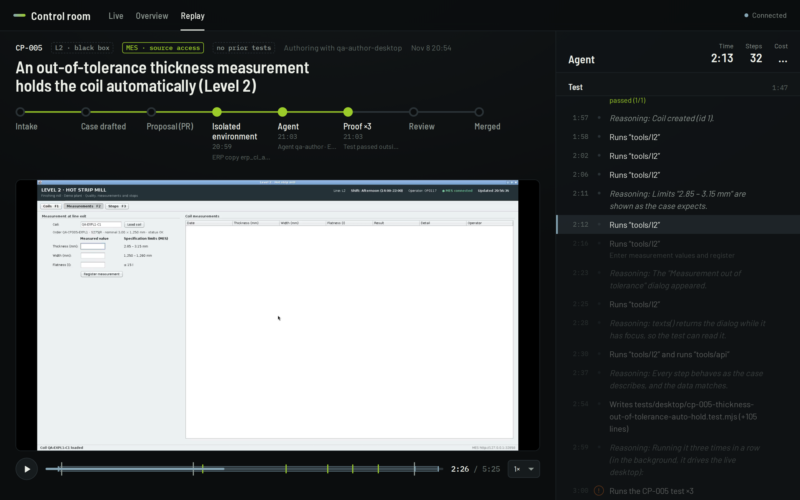
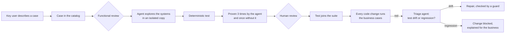

# Agentic QA lab

In this lab, AI agents turn business test cases into deterministic end-to-end tests, keep those tests working as applications change, and explain failures in business terms. It runs on a plant-like landscape: a commercial ERP in the browser, an in-house MES and a vendor's Java desktop client. Every run can be watched live and replayed afterwards.



## Why

In companies with large system landscapes, regression testing of business processes is mostly manual. It is slow, and it depends on the few people who know each flow. Automating it has always been expensive for three reasons:

- Someone has to translate every process into code.
- That code breaks whenever a screen changes.
- Most systems are bought products, and nobody has their source.

Agents that use browsers and desktop applications can now learn a system's screens the way a new key user would. The open question is how to make that reliable, auditable and safe at scale. This repository is one worked answer, built from ordinary parts: Playwright, GitHub Actions, n8n and a language model.

## How it works



The agent explores and writes. A test with fixed data checks decides pass or fail, and no model runs when the test runs. People approve every test before it joins the suite.

## Scenarios

Each story runs with one command, `scenarios/run.sh <name>`, and leaves a pull request, the agent's report and a replay of the run.

| Scenario | What happens |
|---|---|
| `01-business-intake` | A key user fills a form. n8n drafts the case in the catalog template, marks gaps as `PENDING` and opens a PR. After functional review, the agent automates it. |
| `02-desktop-black-box` | A case on the vendor's Java client, which the agent knows only from its screens, with no prior tests. It learns the application from its accessibility tree. |
| `03-cross-system` | One test goes through the ERP in the browser, the MES and the Java client. |
| `04-defect-blocked` | A "performance" change in the MES breaks a business rule. CI blocks it, and the triage agent explains it in business terms. |
| `05-screen-change` | Labels on a screen change. The agent repairs the test, a deterministic guard confirms that no expectation changed, and the test passes again. |
| `06-migration-rehearsal` | A lift and shift of the ERP with the slips a real rehearsal tends to have. The process regression and a business data comparison catch them. |
| `07-parallel-cases` | Four cases at once, web and desktop, with and without source access, on a pool of runners. |
| `08-from-scratch` | The first day on an ERP module nobody prepared (maintenance): no source, no prior tests, no helpers. |

See [docs/guide/scenarios.md](docs/guide/scenarios.md) for what to watch in each one.

## Guardrails

1. Verdicts come from data checks against what the business wrote down, never from a model's opinion.
2. The case catalog, the validation layer and the agents' access policy are protected. Agents cannot edit them or widen their own access.
3. Bought systems are black boxes. The agent works in a sealed copy of the repository that does not contain their code ([policy/agent-access.yaml](policy/agent-access.yaml)).
4. Each run gets its own ERP copy, MES and desktop, created for it and destroyed after it. Nothing touches production.
5. When master data is missing, a case is ambiguous or the application does not do what the case says, the agent stops and reports it. It never adjusts the expectation to make a test pass.
6. Every run is recorded. The control room shows each run's screen and the agent's steps live, and publishes a replay.

[How the boundaries are enforced](docs/internals/agent-boundaries.md)

## Limits

- It does not replace a QA team. It needs well-written cases, functional review and a person who approves each test.
- It tests business processes end to end. Performance, load and security testing are out of scope.
- Desktop automation relies on the accessibility tree. SAP GUI for Windows and Citrix-delivered applications need other approaches.
- What the agent sees (screens and test data) goes to the model provider. Real data calls for masked test data, zero-retention agreements or self-hosted models.

More in the [FAQ](docs/faq.md).

## Run it

Requirements: Docker with Compose v2, Node 24, Python 3, jq, and an Anthropic API key for the agents.

```bash
lab/up.sh                               # ERP, MES, Java desktop, n8n and control room (about 5 min the first time)
scenarios/run.sh                        # list the stories
scenarios/run.sh 08-from-scratch --local   # run one story on this machine, without GitHub
```

The control room is at http://127.0.0.1:17000. For the full loop with pull requests, see [Getting started](docs/guide/getting-started.md).

## Stack

| Part | Built with |
|---|---|
| ERP (stand-in for SAP) | Odoo 19 Community |
| MES | TypeScript on Node 24, Hono, SQLite |
| Level 2 client | Java Swing desktop application |
| Agents | Claude Code in headless mode, Playwright Test Agents, agent-desktop |
| Pipelines | Shell scripts, run by GitHub Actions on self-hosted runners |
| Business workflows | n8n |
| Control room | Hono server, Preact and Vite |

## Documentation

[docs/README.md](docs/README.md) lists the guides, the architecture notes and the runbooks.

## License

[Apache-2.0](LICENSE)
