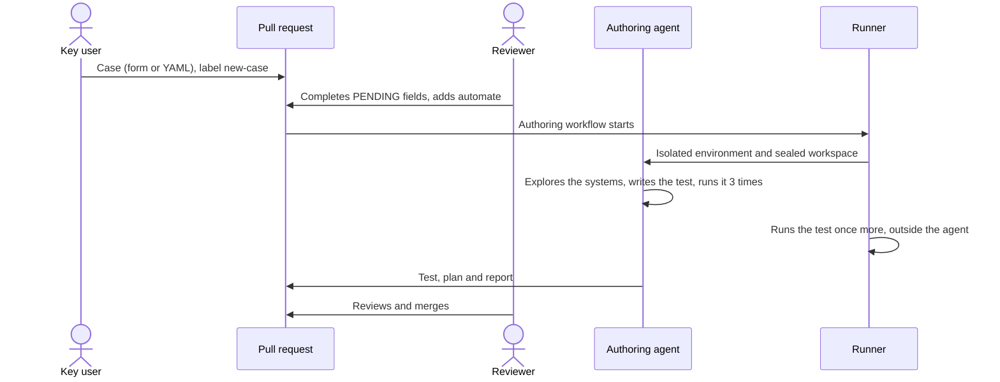

# Writing a business case

A case describes a business process the way the business sees it. It does not mention selectors, test tools or code. The same file is the input for the agent and the reference a reviewer checks the test against.

Cases live in `catalog/cases/CP-NNN.yaml`. The catalog is protected: agents can read it but cannot change it.

## Template

```yaml
# Business case. Written by the business, independent of any tool.
id: CP-001
title: Hot-rolled coil order through to production confirmed in the ERP
process: Order-to-coil
subprocess: Sales order → manufacturing order → rolling → production confirmation
systems: [ERP, MES]
priority: A            # business impact × how often it runs
owner: Production planning (key user)
frequency: daily
preconditions:
  - Customer "Northline Fabrication Ltd." exists in the ERP
data:
  customer: Northline Fabrication Ltd.
  product: Hot-rolled coil S275JR
  quantity_t: 48.5
steps:
  - In the ERP, as a sales rep, create a quotation for the customer and confirm it
  - In the MES, open the order that arrives from the ERP and register the coils
expected_results:
  - The MES order shows "Confirmed in ERP"
data_validation:
  - "ERP mrp.production (origin = order): state = done, qty_produced = 47.75"
dependencies:
  creates: [sales order, finished manufacturing order, 3 coils]
```

`expected_results` is what a person sees. `data_validation` is what the test checks in the systems' data. A test passes only when both hold.

Optional fields:

- `black_box: true` hides all source code from the agent, including in-house systems. Use it to check that a case can be automated from the screens alone.

## From case to test



Labels:

| Label | Effect |
|---|---|
| `new-case` | Marks a PR that adds a case |
| `automate` | Starts the authoring agent |
| `from-scratch` | The agent sees no existing tests or plans, only the support layer |
| `regression` | Set on the issue the triage agent opens for an application regression |

## When the agent stops

The agent reports and stops instead of guessing when:

- master data in the preconditions does not exist (for example, an unknown customer),
- the case is ambiguous or contradicts itself,
- the application does not do what the case expects.

In the last case the agent keeps the expectation, leaves the test red and explains the defect in its report. Someone then decides whether the application or the case is wrong.
