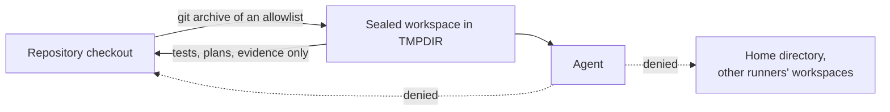

# Agent boundaries

An agent in this lab can explore systems and write tests. It cannot decide what the business expects, change its own permissions, or reach systems outside its run. This page lists how each of those limits is enforced.

## What an agent may know about each system

[`policy/agent-access.yaml`](../../policy/agent-access.yaml) declares every system, whether it is commercial or built in-house, where its source lives, and how an agent may reach it.

| System | Type | Agent access |
|---|---|---|
| ERP | Commercial | Web screens and the documented API (JSON-RPC, the equivalent of BAPI or OData in SAP) |
| Level 2 client | Commercial | Desktop screens, through the accessibility tree |
| MES | In-house | Web screens, REST API and source code |

A case with `black_box: true` gets no source at all, in-house systems included.

## The sealed workspace

`tools/pipeline/author.sh` builds the workspace from the case, the test platform (tests, support layer, tools, skills) and the source of the systems the case may see. The source of black-box systems is not in it. Claude Code permission settings deny reads and writes in the home directory, which holds the checkout and other runners' workspaces. With the `from-scratch` label, existing business tests and plans are removed from the workspace too.

When the agent finishes, only new tests, plans and evidence are copied back.

## Tools

`tools/agent.sh` starts the agent with an explicit tool allowlist: file editing inside the workspace, the Playwright test runner and Playwright Test Agents, `tools/l2` for the desktop client, and `tools/api` for documented interfaces. Shell commands outside the list are refused. `tools/api` only reaches the ERP and MES of the current run.

Each agent run also starts with a clean Claude Code configuration: the repository's instructions and skills, and nothing from the person or service account that launched it (personal skills, plugins, settings or memory). On the lab's runners, workflow code runs as a dedicated user that has no access to anyone's home directory or credentials ([Self-hosted runners](../operations/runners.md)).

## Protected files

| Path | Why |
|---|---|
| `catalog/` | What the business expects |
| `tests/e2e/support/`, `tests/desktop/support/` | The validation layer: data reads and checks the tests rely on |
| `policy/`, `tools/agent.sh` | What agents may access and how they are launched |
| `tools/guard-heal.mjs` | The repair guard itself |
| `.agents/`, `.claude/` | Agent instructions and settings |

Agents are denied writes to these paths in their settings, and CODEOWNERS requires a person's review for any change to them.

## The repair guard

When the triage agent repairs a test for drift, `tools/guard-heal.mjs` compares the repair with the previous version. It rejects the repair if it:

- touches any file other than a web test spec,
- removes assertions,
- changes a line that reads business data or states a business expectation,
- changes a number inside an assertion,
- skips, isolates or marks a test as expected to fail.

A rejected repair is reverted, and the failure is reported as a regression.

## Secrets

Events and replays pass through `tools/emit.mjs`, which replaces the value of any environment variable whose name contains `TOKEN`, `KEY`, `SECRET`, `PASSWORD` or `AUTH` with `[redacted]`.

## Data

Agents only see the lab's test data. With real systems, what the agent sees (screens and data) is sent to the model provider. That calls for masked test data, a zero-retention agreement or a self-hosted model.
