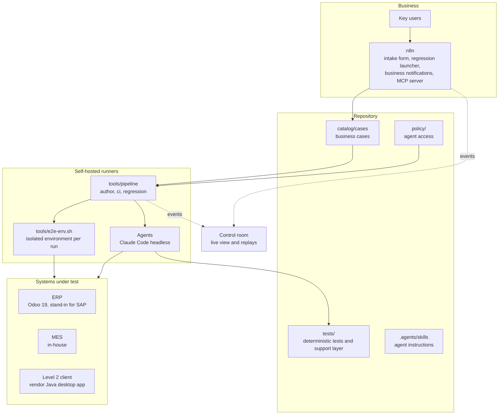
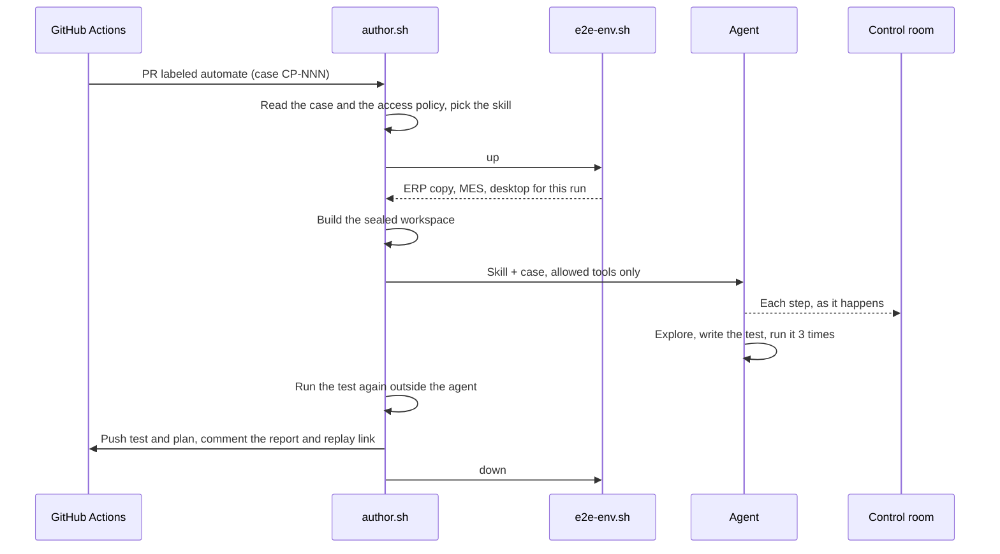

# Architecture

## Components

| Path | Role |
|---|---|
| `apps/mes` | The MES: receives orders from the ERP, registers coils, confirms production back to the ERP |
| `apps/l2-desktop` | The Level 2 client: coils, measurements and line stops, over the MES API |
| `apps/control-room` | Event store and web UI: live runs, Overview, replays |
| `lab/` | Compose file, ERP seed, desktop image, runner setup, migration rehearsal |
| `tools/pipeline/` | Each CI job as a shell script, so any CI system can run it |
| `tools/e2e-env.sh` | Creates and destroys an isolated environment for one run |
| `tools/agent.sh` | Launches an agent with an explicit tool allowlist and permission settings |
| `n8n/` | Generates and loads the n8n workflows |

## An authoring run

The agent is picked from the systems the case touches. Web systems use `qa-author`. A case only on the Level 2 client uses `qa-author-desktop`. A case across web and desktop uses `qa-author`, which writes one Playwright test that also drives the desktop client.

## A change to the code

`tools/pipeline/ci.sh` runs every business case against the change in an isolated environment. If a case fails, the `qa-triage` agent classifies each failure:

| Verdict | Meaning | What happens |
|---|---|---|
| Test drift | The application changed on purpose and still meets the case | The agent repairs locators, the guard checks the repair, the suite runs again |
| Application regression | The application no longer meets the case | The PR is blocked, an issue explains the failure for the business |
| Environment | A service was down or data was missing | Reported to the platform owner |
| Flaky | Passed on a rerun without changes | Reported, the wait gets fixed |

When the agent is unsure between drift and regression, it reports a regression.

## Isolated environments

Each run calls `tools/e2e-env.sh up <run>` and gets:

- an ERP database copied from the seeded one (Odoo `duplicate_database`, a Postgres template copy that takes seconds),
- an MES container built from the run's checkout and pointed at that copy,
- a desktop container with its own X display, VNC port and accessibility bus, running the Level 2 client from the run's checkout.

Runs never share data or screens, so several can run on one host. The database copy and the choice of display are serialized with a host-wide lock. `tools/e2e-env.sh down <run>` removes everything, and the workflows call it even when a run is cancelled.

## Recording

Each run's desktop is recorded with ffmpeg while the run is in progress. The pipeline sends stage events and the agent's stream to the control room, which can export a run as a static replay page.
